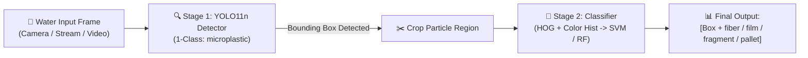

# Edge AI-Powered Smart Microscope for Microplastic Detection in Water

An AI-enabled optical microscopy system designed for real-time detection, tracking, and morphological classification of microplastics in water samples, optimized for Edge AI deployment (NVIDIA Jetson Nano, Raspberry Pi).

> **🎓 Academic Note**: This repository hosts the implementation, datasets, and models for the **Bachelor of Engineering (B.E.) Final Year Capstone Project**:  
> *"Edge AI-Powered Smart Microscope for Microplastic Detection in Water"*.

[](#-about-the-project)
[](https://huggingface.co/datasets/amateurmind/microplastic-detection)
[](https://app.roboflow.com/mohammad-suhail/microplastic-detection-oiqbo)
[](#stage-1-yolo11n-detector)
[](#stage-2-particle-classifier)

---

## 🔬 About the Project

Microplastic pollution in aquatic ecosystems is a critical environmental hazard. Conventional laboratory analysis (FTIR, Raman spectroscopy) is time-consuming, expensive, and non-portable. 

This project integrates a **digital microscope / optical sensor** with an **Edge-AI computing unit** (NVIDIA Jetson Nano / Raspberry Pi) to automate on-site water quality assessment:
- **Optical Input**: High-resolution microscopic feed from glass slides or continuous water flow-cells.
- **Stage 1 (YOLO11n)**: Rapid localization of microplastic particles with ultra-low latency.
- **Stage 2 (Morphological Classification)**: Instant classification of extracted particles into `fiber`, `film`, `fragment`, and `pallet`.

---

## 🎯 Architecture: Two-Stage Pipeline

To overcome the label conflict where some datasets use generic `"microplastic"` while others annotate specific particle types (`"fiber"`, `"film"`), this system utilizes a **Two-Stage Detection + Classification Pipeline**:



### Why this 2-Stage Design?
1. **Zero Label Ambiguity**: The detector is trained on all unified datasets without conflicting loss penalties.
2. **Edge-Optimized**: Stage 1 runs in real-time (>150 FPS on GPU, low CPU overhead on Raspberry Pi). Stage 2 is only triggered when particles are present.
3. **High Specificity**: Achieves **82.4% mAP@50** for detection and **99.79% accuracy** for classification.

---

## 📈 Performance Summary

### Stage 1: YOLO11n Detector (`best.pt`)
- **Task**: Particle localization and bounding box extraction
- **Class**: Single class (`0: microplastic`)
- **Metrics (50 Epochs)**:
  - **Precision**: 86.1%
  - **Recall**: 75.5%
  - **mAP@50**: 82.4%
  - **mAP@50-95**: 40.8%
  - **Inference Speed**: ~4.7 ms / image
  - **Model Footprint**: 5.5 MB (ultra-lightweight for Edge devices)

### Stage 2: Particle Classifier (`svm_classifier.pkl` / `rf_classifier.pkl`)
- **Task**: Specific particle morphology classification
- **Classes**: `fiber`, `film`, `fragment`, `pallet`
- **Feature Extraction**: 9-orientation HOG (Shape) + 3D Color Histograms (Color)
- **Validation Accuracy**: **99.79%** across all test splits

| Class | Precision | Recall | F1-Score | Support |
|---|---|---|---|---|
| **fiber** | 1.00 | 1.00 | 1.00 | 247 |
| **film** | 1.00 | 1.00 | 1.00 | 242 |
| **fragment** | 1.00 | 1.00 | 1.00 | 230 |
| **pallet** | 1.00 | 0.99 | 1.00 | 212 |
| **Accuracy** | | | **0.9979** | 931 |

---

## 🚀 Quick Start & Inference

### 1. Environment Setup

```bash
# Create and activate environment
conda create -n yolo python=3.10 -y
conda activate yolo

# Install PyTorch with CUDA support
conda install pytorch torchvision torchaudio pytorch-cuda=11.8 -c pytorch -c nvidia

# Install dependencies
pip install ultralytics scikit-learn scikit-image opencv-python huggingface_hub
```

### 2. Run the Unified Two-Stage Pipeline

```bash
# Test on a single image
python scripts/detect_and_classify.py --source "path/to/image.jpg"

# Test on a folder of images
python scripts/detect_and_classify.py --source "merged_dataset/test/images"

# Real-time webcam / USB camera feed (Edge deployment)
python scripts/detect_and_classify.py --source 0

# Video file inference
python scripts/detect_and_classify.py --source "path/to/video.mp4"

# Use Random Forest instead of SVM
python scripts/detect_and_classify.py --source 0 --classifier rf
```

---

## 📦 Dataset Download (Hugging Face)

The complete merged dataset is hosted on Hugging Face:  
🔗 **[amateurmind/microplastic-detection](https://huggingface.co/datasets/amateurmind/microplastic-detection)**

Download and extract automatically with Python:

```python
from huggingface_hub import hf_hub_download
import zipfile

zip_file = hf_hub_download(
    repo_id="amateurmind/microplastic-detection",
    filename="merged_dataset.zip",
    repo_type="dataset"
)

with zipfile.ZipFile(zip_file, 'r') as zip_ref:
    zip_ref.extractall("merged_dataset")
```

---

## 🛠️ Retraining the Pipeline

If you want to retrain on your own data:

```bash
# Step 1: Remap merged dataset to single class (0: microplastic)
python scripts/remap_labels_1class.py

# Step 2: Retrain Stage 2 classifier on specific morphology classes
python scripts/retrain_classifier.py

# Step 3: Train Stage 1 YOLO11n detector
python scripts/train_yolov11.py
```

---

## 📁 Repository Structure

```text
├── scripts/
│   ├── detect_and_classify.py     # Main end-to-end inference pipeline
│   ├── retrain_classifier.py      # Stage 2 SVM/RF training script
│   ├── train_yolov11.py           # Stage 1 YOLO11n training script
│   ├── remap_labels_1class.py     # Utility to convert labels to 1-class
│   ├── dataset_cropper.py         # Utility to crop bounding boxes for classification
│   └── upload_to_hf.py            # Automated Hugging Face upload script
├── merged_dataset/
│   ├── data_1class.yaml           # 1-Class YOLO dataset config
│   └── data.yaml                  # Multi-class YOLO dataset config
├── models/
│   ├── classifier_classes.txt     # Class list for Stage 2
│   ├── svm_classifier.pkl         # Trained SVM classifier (99.79% Acc)
│   ├── rf_classifier.pkl          # Trained Random Forest classifier (99.79% Acc)
│   └── yolov11/                   # YOLO11n training outputs, curves & metrics
├── .gitignore                     # Excludes heavy dataset images and checkpoints
└── README.md
```

---

## 📜 Citation & Academic Use

If you use this dataset, models, or pipeline in your research or academic project, please cite:

```bibtex
@misc{smart_microscope_microplastics_2026,
  author = {Suhail, Mohammad and Contributors},
  title = {Edge AI-Powered Smart Microscope for Microplastic Detection in Water},
  year = {2026},
  howpublished = {Bachelor of Engineering Final Year Capstone Project},
  url = {https://github.com/AmateurMind/Microplastic_rasberry_jetsonnano}
}
```
